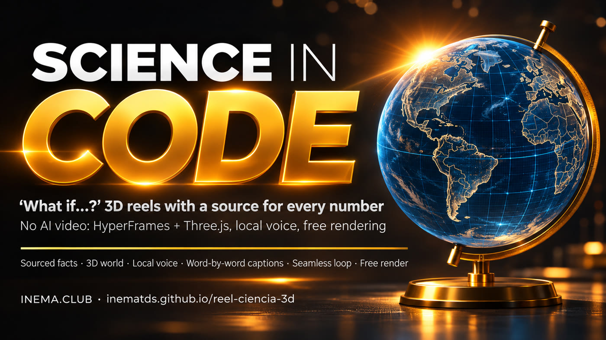

# reel-ciencia-3d — “What if…?” science reels made entirely with code

[](https://inematds.github.io/reel-ciencia-3d/guia/en/)

**🇧🇷 [Português](README.md) · 🇺🇸 [English](README.en.md) · 🇪🇸 [Español](README.es.md)**

## What it is

reel-ciencia-3d is a kit with a skill for Claude Code: it turns a question like “What if Earth had no tilt?” into a vertical video of about 60 seconds for Reels, Shorts, and TikTok. It’s for teachers, science communicators, and creators who want science videos without getting the numbers wrong. Everything is made with code (HyperFrames for the video, Three.js for 3D); every number appears with its source, the voice is generated on your computer, and the reel loops seamlessly. You need Node.js, ffmpeg, and Claude Code.

## 📖 User guide

Complete guide (landing page + walkthrough): **https://inematds.github.io/reel-ciencia-3d/guia/en/**

## What it looks like

A “What if…?” question becomes a ~60-second vertical reel: a 3D world (Three.js) inside HyperFrames, every number shown with its source, voice generated on your computer and timed to each word, music made with code, and the last frame matching the first (the reel loops seamlessly). No AI-generated images or video. Free rendering on your computer.

**Why code instead of video AI:** science requires exact numbers. A video model gets labels wrong, changes the chart from one scene to the next, and every fix costs credits. With code, the number on screen is the one you entered, the visuals stay consistent across every reel, and you can fix a mistake in one line and render again for free.

## What’s included in the kit

| Folder | What |
|---|---|
| `SKILL.md` | The skill for Claude Code / Codex: the 13-step process and the engine components |
| `STYLE.md` | The INEMA look for the reels (colors, fonts, placement, movement, sound, things to avoid) |
| `prompts/` | The request card (copy it and change the question) and 8 short decisions |
| `checklists/` | Facts · judge the frames (3 questions) · before publishing |
| `motor/` | `base.js` (two looks, sky, globe with real continents, labels, captions, cards), `reel.css`, fonts, three.js, Natural Earth outlines |
| `ferramentas/` | `voz.py` (local voice + timing for every word), `montar.py` (reel timing and captions), `mezcla.py` (code-generated music + mixing), `preparar.py` |
| `exemplos/` | 3 complete reels, each with `fatos.md`, `roteiro.json`, `index.html`, `js/mundo.js`, voice, and sound ready to go (render with `npx hyperframes render`; lightweight MP4 versions are in `guia/assets/`) |

## The 3 examples

| Reel | Mechanism | What makes it different |
|---|---|---|
| **What if Earth had no tilt?** (`exemplos/terra-sem-inclinacao`) | tilt 23.4° → 0° + day of the year | Porto Alegre, Manaus, and Comandante Ferraz Antarctic Station; globe with real continents; the Sun rolling along the polar horizon |
| **What if the Sun disappeared right now?** (`exemplos/sol-sumisse`) | “time without the Sun” timer + temperature | the 8 min 20 s it takes light to reach us, Earth leaving its orbit in a straight line, life around hydrothermal vents |
| **What if the Moon disappeared?** (`exemplos/lua-sumisse`) | “time without the Moon” + tide height | tides in São Luís, corals that spawn by moonlight, Earth’s axis |

## The process, from start to finish

🧠 = you (the director) · 🤖 = Claude Code · ⚙️ = script

1. 🧠 Choose the question and the one answer the reel needs to prove.
2. 🤖 **Facts first:** `exemplos/<id>/fatos.md`, source for every number. No source, leave it out.
3. 🤖→🧠 Script 8–10 beats on an increasing scale (`roteiro.json`). You approve it.
4. ⚙️ Voice: `python3 ferramentas/voz.py --projeto exemplos/<id> exemplos/<id>/roteiro.json`
5. ⚙️ Timing and captions: `python3 ferramentas/montar.py --projeto exemplos/<id>`
6. ⚙️ Music and mixing: `python3 ferramentas/mezcla.py --projeto exemplos/<id> --id <rid> --musica tranquila` (`<rid>` = the `"id"` in `roteiro.json`)
7. 🤖 Page and 3D world (`index.html`, `js/mundo.js`) based on an example, copied before step 4: `mkdir -p exemplos/<id>/js && cp exemplos/terra-sem-inclinacao/{index.html,hyperframes.json,package.json,roteiro.json} exemplos/<id>/ && cp exemplos/terra-sem-inclinacao/js/mundo.js exemplos/<id>/js/` (don’t copy `js/tempos.js`: it is generated by `montar.py`).
8. ⚙️ `python3 ferramentas/preparar.py --projeto exemplos/<id>`
9. ⚙️ `npx hyperframes check` → 0 errors.
10. 🤖 One still image per scene: `npx hyperframes snapshot --at <times> --no-end -o stills`
11. 🧠 Judge using the 3 questions (`checklists/julgar-quadros.md`); ask for **one change at a time**.
12. ⚙️ Render: `npx hyperframes render --output renders/<id>.mp4` (~5 min for 65 s).
13. 🤖+🧠 Judge the actual MP4 and complete `checklists/antes-de-publicar.md`.

## Install

```bash
git clone https://github.com/inematds/reel-ciencia-3d && cd reel-ciencia-3d
bash instalar.sh            # connects the skill to Claude Code/Codex and tests HyperFrames
```

Requires: Node.js 22+, ffmpeg, Python 3 with numpy (`python3 -m pip install numpy`), Claude Code (or Codex). HyperFrames installs itself the first time (`npx hyperframes doctor` tells you what’s missing).
Local voice (optional): `voz.py` uses Chatterbox (generates speech from ~15 s of your voice) and Whisper (timestamps every word), from [inemavox](https://github.com/inematds/inemavox). Variables: `INEMAVOX_DIR` (inemavox folder), `CHATTERBOX_PYTHON` (the Chatterbox environment’s Python), `VC_VOZ=/path/your-voice.wav`.
Without local voice: `python3 ferramentas/montar.py --projeto exemplos/<id> --sem-voz` estimates the timing of every word from the text, and `mezcla.py --duracao <end>` makes only the music; the reel is rendered with captions and music.

To render a ready-made example:
```bash
cd exemplos/terra-sem-inclinacao
npx hyperframes check
npx hyperframes render --output renders/teste.mp4
```

## Costs

Rendering: R$ 0 (on your computer). Voice and music: R$ 0 (local). Claude: your plan.

## Licenses

Kit code: MIT. three.js: MIT (`motor/lib/LICENSE-three.js.txt`). Continent outlines: Natural Earth (public domain). Sora, Inter, JetBrains Mono, and Montserrat fonts: SIL OFL (`motor/fontes/OFL.txt`). HyperFrames (Apache 2.0) and GSAP are downloaded by the tools.

Made by INEMA — open, free content at [inema.club](https://inema.club).

## Self-learning

When something goes wrong while using the kit, write the lesson as a line at the top of `FALHAS.md`.

## Lessons

- The dark WHAT IF look is too dark: add light with `emissive` in the materials; black isn’t a “technical blueprint.”
- At 9:16, the visible width is small: a globe with radius 3 and fov 36 needs the camera at 17–20 units.
- Title on frame 0: `data-de="0"`; a bare number in `data-ate` is a time, not a phrase name.