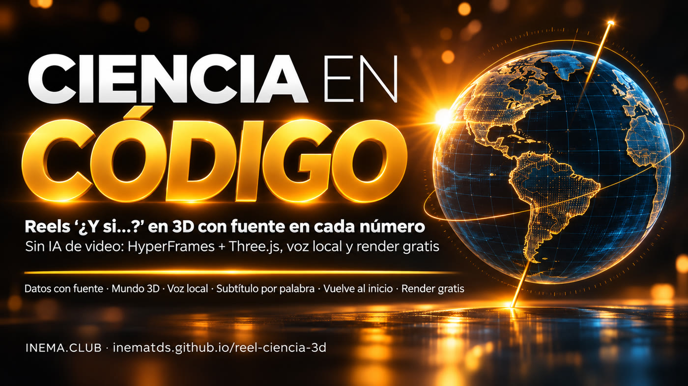

# reel-ciencia-3d — reels de ciencia «¿Y si…?» hechos solo con código

[](https://inematds.github.io/reel-ciencia-3d/guia/es/)

**🇧🇷 [Português](README.md) · 🇺🇸 [English](README.en.md) · 🇪🇸 [Español](README.es.md)**

## Qué es

reel-ciencia-3d es un kit con una skill para Claude Code: transforma una pregunta como «¿Y si la Tierra no tuviera inclinación?» en un video vertical de unos 60 segundos para Reels, Shorts y TikTok. Está pensado para docentes, divulgadores y creadores que quieren hacer videos de ciencia sin equivocarse con los datos. Todo se hace con código (HyperFrames para el video, Three.js para el 3D); cada dato aparece con su fuente, la voz se genera en tu computadora y el reel vuelve al inicio sin cortes. Necesitas Node.js, ffmpeg y Claude Code.

## 📖 Guía de uso

Guía completa (landing + paso a paso): **https://inematds.github.io/reel-ciencia-3d/guia/es/**

## Cómo es

Una pregunta «¿Y si…?» se convierte en un reel vertical de ~60 s: un mundo 3D (Three.js) dentro de HyperFrames, cada dato con su fuente en pantalla, voz generada en tu computadora y sincronizada con cada palabra, música hecha con código y el último cuadro igual al primero (el reel vuelve al inicio sin cortes). No se usan imágenes ni videos creados con IA. Renderizado gratis, en tu computadora.

**Por qué usar código y no IA de video:** la ciencia exige datos exactos. Un modelo de video se equivoca con las etiquetas, cambia los gráficos de una escena a otra y cada corrección cuesta créditos. Con código, el dato en pantalla es el que escribiste, el aspecto es el mismo en todos los reels y cualquier error se corrige en una línea, con otro render gratuito.

## Qué incluye el kit

| Carpeta | Qué contiene |
|---|---|
| `SKILL.md` | La skill para Claude Code / Codex: el proceso de 13 pasos y las piezas del motor |
| `STYLE.md` | El estilo visual INEMA de los reels (colores, fuentes, ubicación de cada elemento, movimiento, sonido y elementos prohibidos) |
| `prompts/` | La tarjeta de solicitud (cópiala y cambia la pregunta) y 8 decisiones breves |
| `checklists/` | Datos · evaluación de los cuadros (3 preguntas) · antes de publicar |
| `motor/` | `base.js` (dos apariencias, cielo, globo con continentes reales, etiquetas, subtítulos y tarjetas), `reel.css`, fuentes, three.js, contornos de Natural Earth |
| `ferramentas/` | `voz.py` (voz local + tiempos de cada palabra), `montar.py` (reloj del reel y subtítulos), `mezcla.py` (música hecha con código + mezcla), `preparar.py` |
| `exemplos/` | 3 reels completos, cada uno con `fatos.md`, `roteiro.json`, `index.html`, `js/mundo.js`, voz y sonido listos (renderiza con `npx hyperframes render`; versiones livianas de los MP4 en `guia/assets/`) |

## Los 3 ejemplos

| Reel | Recurso visual | Qué tiene de diferente |
|---|---|---|
| **¿Y si la Tierra no tuviera inclinación?** (`exemplos/terra-sem-inclinacao`) | inclinación 23,4° → 0° + día del año | Porto Alegre, Manaus y la Estación Antártica Comandante Ferraz; globo con continentes reales; el Sol rodando sobre el horizonte del polo |
| **¿Y si el Sol desapareciera ahora?** (`exemplos/sol-sumisse`) | cronómetro «tiempo sin Sol» + temperatura | los 8 min 20 s que tarda la luz, la Tierra saliendo de su órbita en línea recta, la vida en las fuentes hidrotermales |
| **¿Y si la Luna desapareciera?** (`exemplos/lua-sumisse`) | «tiempo sin Luna» + altura de la marea | mareas de São Luís, corales que desovan según la Luna, el eje de la Tierra |

## El proceso, de principio a fin

🧠 = tú (el director) · 🤖 = Claude Code · ⚙️ = script

1. 🧠 Elige la pregunta y la única respuesta que el reel debe demostrar.
2. 🤖 **Primero los datos:** `exemplos/<id>/fatos.md`, una fuente por dato. Sin fuente, queda fuera.
3. 🤖→🧠 Guion de 8–10 momentos en escala creciente (`roteiro.json`). Tú lo apruebas.
4. ⚙️ Voz: `python3 ferramentas/voz.py --projeto exemplos/<id> exemplos/<id>/roteiro.json`
5. ⚙️ Reloj y subtítulos: `python3 ferramentas/montar.py --projeto exemplos/<id>`
6. ⚙️ Música y mezcla: `python3 ferramentas/mezcla.py --projeto exemplos/<id> --id <rid> --musica tranquila` (`<rid>` = el `"id"` de `roteiro.json`)
7. 🤖 Página y mundo 3D (`index.html`, `js/mundo.js`) a partir de un ejemplo: `cp exemplos/terra-sem-inclinacao/{index.html,hyperframes.json,package.json} exemplos/<id>/ && cp -r exemplos/terra-sem-inclinacao/js exemplos/<id>/`.
8. ⚙️ `python3 ferramentas/preparar.py --projeto exemplos/<id>`
9. ⚙️ `npx hyperframes check` → 0 errores.
10. 🤖 Una imagen fija por escena: `npx hyperframes snapshot --at <tempos> --no-end -o stills`
11. 🧠 Evalúa con las 3 preguntas (`checklists/julgar-quadros.md`); pide **un cambio a la vez**.
12. ⚙️ Renderizado: `npx hyperframes render --output renders/<id>.mp4` (~5 min para 65 s).
13. 🤖+🧠 Evalúa el MP4 real y completa `checklists/antes-de-publicar.md`.

## Instalar

```bash
git clone https://github.com/inematds/reel-ciencia-3d && cd reel-ciencia-3d
bash instalar.sh            # activa la skill en Claude Code/Codex y prueba HyperFrames
```

Necesitas: Node.js 22+, ffmpeg, Claude Code (o Codex). HyperFrames se descarga automáticamente la primera vez (`npx hyperframes doctor` indica qué falta).
Voz local (opcional): `voz.py` usa Chatterbox (genera el habla a partir de ~15 s de tu voz) y Whisper (marca el tiempo de cada palabra), de [inemavox](https://github.com/inematds/inemavox). Variables: `INEMAVOX_DIR` (carpeta de inemavox), `CHATTERBOX_PYTHON` (el Python del entorno de Chatterbox), `VC_VOZ=/caminho/sua-voz.wav`.
Sin voz local: `python3 ferramentas/montar.py --projeto exemplos/<id> --sem-voz` estima el tiempo de cada palabra a partir del texto, y `mezcla.py --duracao <fim>` genera solo la música; el reel sale con subtítulos y música.

Para renderizar un ejemplo listo:
```bash
cd exemplos/terra-sem-inclinacao
npx hyperframes check
npx hyperframes render --output renders/teste.mp4
```

## Costos
Renderizado: R$ 0 (en tu computadora). Voz y música: R$ 0 (locales). Claude: tu plan.

## Licencias
Código del kit: MIT. three.js: MIT (`motor/lib/LICENSE-three.js.txt`). Contornos de los continentes: Natural Earth (dominio público). Fuentes Sora, Inter, JetBrains Mono, Montserrat: SIL OFL (`motor/fontes/OFL.txt`). HyperFrames (Apache 2.0) y GSAP se descargan con las herramientas.

Hecho por INEMA — contenido abierto y gratuito en [inema.club](https://inema.club).

## Aprendizaje autónomo
Cuando algo salga mal al usar el kit, anota la lección como una línea al comienzo de `FALHAS.md`.

## Lecciones
- Apariencia «¿Y si…?» demasiado oscura: usa luz propia (`emissive`) en los materiales; el negro no es una «planta técnica».
- En 9:16 el ancho visible es pequeño: un globo de radio 3 con fov 36 necesita una cámara a 17–20 unidades.
- Título en el cuadro 0: `data-de="0"`; un número sin más en `data-ate` indica tiempo, no el nombre de una frase.