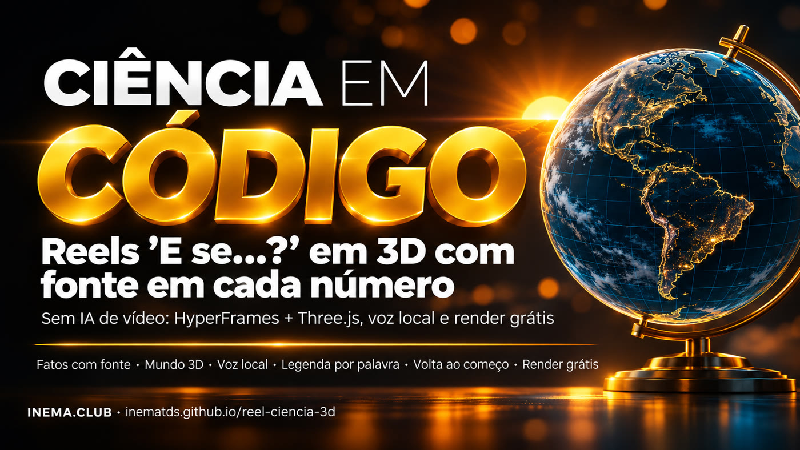

# reel-ciencia-3d — reels de ciência "E se…?" feitos só com código

[](https://inematds.github.io/reel-ciencia-3d/guia/)

**🇧🇷 [Português](README.md) · 🇺🇸 [English](README.en.md) · 🇪🇸 [Español](README.es.md)**

## O que é

O reel-ciencia-3d é um kit com uma skill para o Claude Code: transforma uma pergunta como "E se a Terra não tivesse inclinação?" num vídeo vertical de cerca de 60 segundos para Reels, Shorts e TikTok. Serve para professor, divulgador e criador que quer vídeo de ciência sem errar número. Tudo é feito com código (HyperFrames para o vídeo, Three.js para o 3D), cada número aparece com a fonte, a voz é gerada no seu computador e o reel volta ao começo sem emenda. Você precisa de Node.js, ffmpeg e do Claude Code.

## 📖 Guia de uso

Guia completo (landing + passo a passo): **https://inematds.github.io/reel-ciencia-3d/guia/**

## Como é

Uma pergunta "E se…?" vira um reel vertical de ~60 s: mundo 3D (Three.js) dentro do HyperFrames, cada número com a fonte na tela, voz gerada no seu computador presa à palavra, música feita em código e o último quadro igual ao primeiro (o reel volta ao começo sem emenda). Nenhuma imagem ou vídeo desenhado por IA. Render grátis, no seu computador.

**Por que código e não IA de vídeo:** ciência pede número exato. Um modelo de vídeo erra rótulo, muda o gráfico de uma cena para a outra e cada conserto custa crédito. Com código, o número na tela é o que você digitou, o visual é o mesmo em todo reel, e um erro se conserta numa linha, com render de novo de graça.

## O que vem no kit

| Pasta | O quê |
|---|---|
| `SKILL.md` | A skill para Claude Code / Codex: o processo de 13 passos e as peças do motor |
| `STYLE.md` | O visual INEMA dos reels (cores, fontes, lugar de cada coisa, movimento, som, proibidos) |
| `prompts/` | O cartão de pedido (cole e troque a pergunta) e 8 decisões curtas |
| `checklists/` | Fatos · julgar os quadros (3 perguntas) · antes de publicar |
| `motor/` | `base.js` (duas aparências, céu, globo com continentes reais, rótulos, legenda, cartões), `reel.css`, fontes, three.js, contornos Natural Earth |
| `ferramentas/` | `voz.py` (voz local + tempo de cada palavra), `montar.py` (relógio do reel e legenda), `mezcla.py` (música em código + mistura), `preparar.py` |
| `exemplos/` | 3 reels completos, cada um com `fatos.md`, `roteiro.json`, `index.html`, `js/mundo.js`, voz e som prontos (renderize com `npx hyperframes render`; versão leve dos MP4 em `guia/assets/`) |

## Os 3 exemplos

| Reel | Aparelho | O que tem de diferente |
|---|---|---|
| **E se a Terra não tivesse inclinação?** (`exemplos/terra-sem-inclinacao`) | inclinação 23,4° → 0° + dia do ano | Porto Alegre, Manaus e a Estação Antártica Comandante Ferraz; globo com os continentes reais; o Sol rolando no horizonte do polo |
| **E se o Sol sumisse agora?** (`exemplos/sol-sumisse`) | cronômetro "tempo sem Sol" + temperatura | os 8 min 20 s da luz, a Terra saindo da órbita em linha reta, a vida nas fontes hidrotermais |
| **E se a Lua sumisse?** (`exemplos/lua-sumisse`) | "sem Lua há" + altura da maré | marés de São Luís, corais que desovam pela Lua, o eixo da Terra |

## O processo, do início ao fim

🧠 = você (o diretor) · 🤖 = Claude Code · ⚙️ = script

1. 🧠 Escolha a pergunta e a única resposta que o reel tem que provar.
2. 🤖 **Fatos primeiro:** `exemplos/<id>/fatos.md`, fonte por número. Sem fonte, fica de fora.
3. 🤖→🧠 Roteiro de 8–10 batidas em escala crescente (`roteiro.json`). Você aprova.
4. ⚙️ Voz: `python3 ferramentas/voz.py --projeto exemplos/<id> exemplos/<id>/roteiro.json`
5. ⚙️ Relógio e legenda: `python3 ferramentas/montar.py --projeto exemplos/<id>`
6. ⚙️ Música e mistura: `python3 ferramentas/mezcla.py --projeto exemplos/<id> --id <rid> --musica tranquila` (`<rid>` = o `"id"` do roteiro.json)
7. 🤖 Página e mundo 3D (`index.html`, `js/mundo.js`) a partir de um exemplo, copiados antes do passo 4: `mkdir -p exemplos/<id>/js && cp exemplos/terra-sem-inclinacao/{index.html,hyperframes.json,package.json,roteiro.json} exemplos/<id>/ && cp exemplos/terra-sem-inclinacao/js/mundo.js exemplos/<id>/js/` (não copie o `js/tempos.js`: ele é gerado pelo `montar.py`).
8. ⚙️ `python3 ferramentas/preparar.py --projeto exemplos/<id>`
9. ⚙️ `npx hyperframes check` → 0 erros.
10. 🤖 Uma imagem parada por cena: `npx hyperframes snapshot --at <tempos> --no-end -o stills`
11. 🧠 Julgue com as 3 perguntas (`checklists/julgar-quadros.md`); peça **uma mudança por vez**.
12. ⚙️ Render: `npx hyperframes render --output renders/<id>.mp4` (~5 min para 65 s).
13. 🤖+🧠 Julgue o MP4 de verdade e passe o `checklists/antes-de-publicar.md`.

## Instalar

```bash
git clone https://github.com/inematds/reel-ciencia-3d && cd reel-ciencia-3d
bash instalar.sh            # liga a skill no Claude Code/Codex e testa o HyperFrames
```

Precisa de: Node.js 22+, ffmpeg, Python 3 com numpy (`python3 -m pip install numpy`), Claude Code (ou Codex). O HyperFrames baixa sozinho na primeira vez (`npx hyperframes doctor` diz o que falta).
Voz local (opcional): o `voz.py` usa o Chatterbox (gera a fala a partir de ~15 s da sua voz) e o Whisper (marca o tempo de cada palavra), do [inemavox](https://github.com/inematds/inemavox). Variáveis: `INEMAVOX_DIR` (pasta do inemavox), `CHATTERBOX_PYTHON` (o Python do ambiente do Chatterbox), `VC_VOZ=/caminho/sua-voz.wav`.
Sem voz local: `python3 ferramentas/montar.py --projeto exemplos/<id> --sem-voz` estima o tempo de cada palavra pelo texto, e `mezcla.py --duracao <fim>` faz só a música; o reel sai com legenda e música.

Para renderizar um exemplo pronto:
```bash
cd exemplos/terra-sem-inclinacao
npx hyperframes check
npx hyperframes render --output renders/teste.mp4
```

## Custos
Render: R$ 0 (no seu computador). Voz e música: R$ 0 (locais). Claude: o seu plano.

## Licenças
Código do kit: MIT. three.js: MIT (`motor/lib/LICENSE-three.js.txt`). Contornos dos continentes: Natural Earth (domínio público). Fontes Sora, Inter, JetBrains Mono, Montserrat: SIL OFL (`motor/fontes/OFL.txt`). HyperFrames (Apache 2.0) e GSAP são baixados pelas ferramentas.

Feito pelo INEMA — conteúdo aberto e gratuito em [inema.club](https://inema.club).

## Self-learning
Quando algo der errado ao usar o kit, anote a lição como uma linha no topo de `FALHAS.md`.

## Lessons
- Aparência E SE escura demais: usar luz própria (`emissive`) nos materiais; preto não é "planta técnica".
- Em 9:16 a largura visível é pequena: globo de raio 3 com fov 36 pede câmera a 17–20 unidades.
- Título no quadro 0: `data-de="0"`; número puro em `data-ate` é tempo, não nome de frase.
